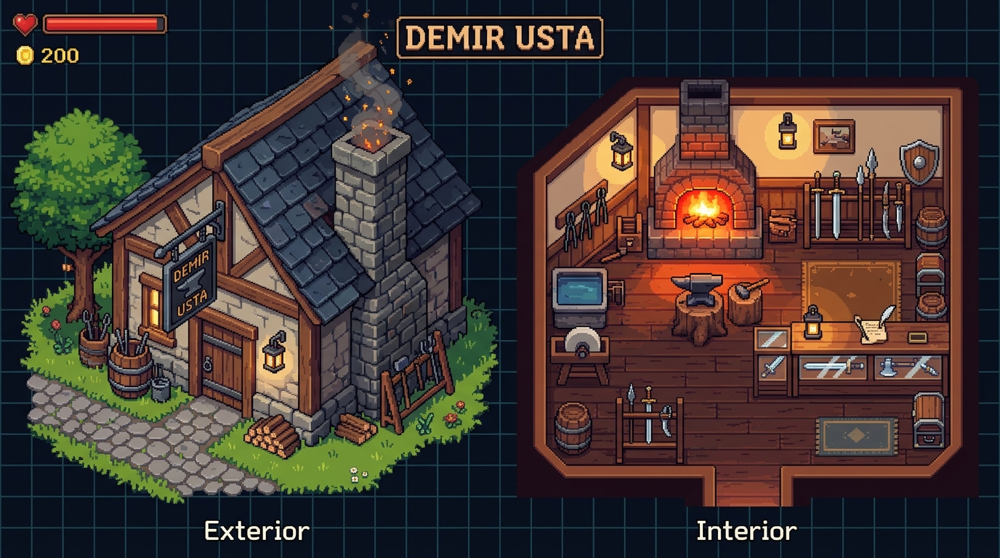
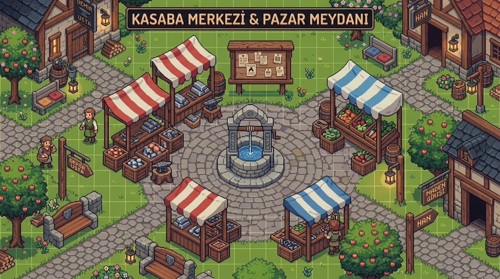
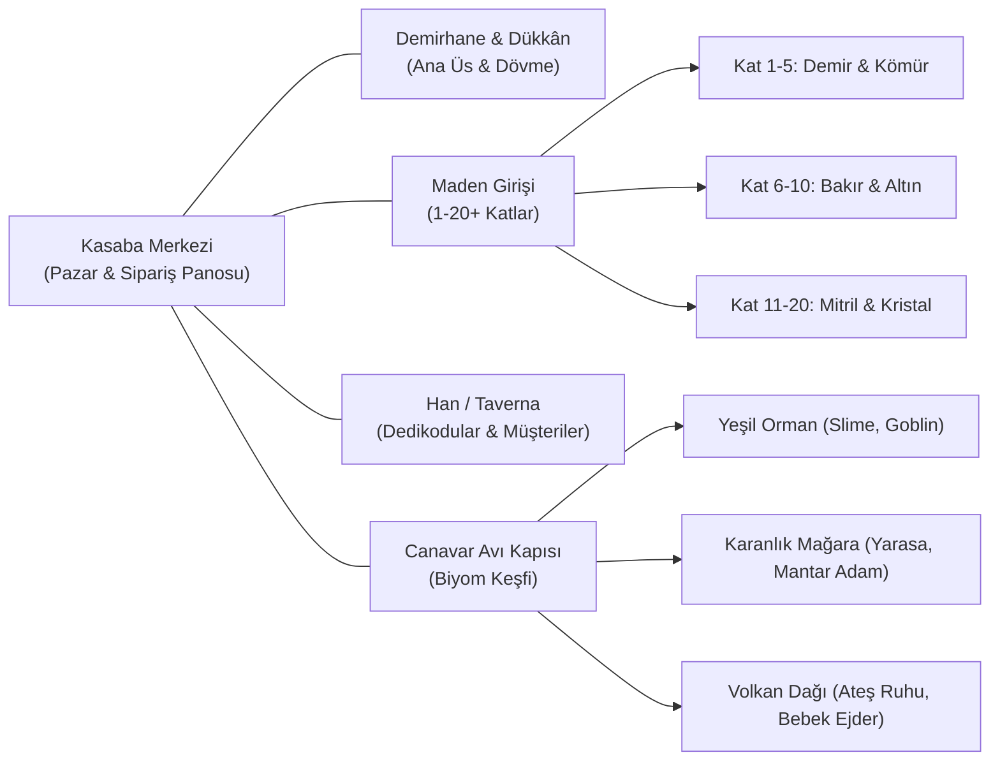

# 🏡 Demir Usta — Dünya & Mekan Tasarım Rehberi

Demir Usta'nın piksel dünyası, oyuncuya sıcacık bir zanaat ve kasaba hayatı hissi sunacak şekilde (Stardew Valley / Moonlighter esintili) katmanlara ayrılmıştır.

---

## ⚒️ 1. Demirhane & Dükkân (Blacksmith Shop: Dış & İç Mekân)

Demirhane, oyuncunun üssüdür. İki ana bileşenden oluşur:
1. **Dış Cephe:** Taş ve ahşap kütüklerden örülmüş, bacasından duman tüten, asma örs tabelalı, kütük ve su varilli atölye binası.
2. **İç Mekân:** Dövme alanı (örs, körük, pota, bileme taşı, su teknesi) ve satış/vitrin alanı (ahşap tezgâh, sergi rafları, sipariş panosu).

### Demirhane Mimari & Fonksiyon Detayları:
- **Dış Kısım:**
  - **Tüten Baca & Ocak Borusu:** Fırından çıkan ısıyı dışarı atan boru sistemi ve sıcak duman animasyonu.
  - **Asma Tabela:** Demirci örsü sembollü ahşap sallanan tabela.
  - **Su Varili / Quench Trough:** Dışarıda soğutma ve yıkama için kullanılan büyük ahşap fıçı.
  - **Odun ve Kömür Yığını:** Ocağın yakıt stoğunu gösteren görsel detay.
- **İç Kısım (Atölye & Mağaza):**
  - **Közlü Ocak & Körük:** Sıcaklığın yönetildiği kor ateş yatağı.
  - **Ağır Örs:** Ritimli vuruşların yapıldığı çalışma merkezi.
  - **Bileme Taşı:** Ağız keskinleştirme istasyonu.
  - **Silah Vitrinleri:** Oyuncunun dövdüğü kılıçları, baltaları ve hançerleri kadife kumaşlar veya ahşap oyuklar üzerinde sergilediği Moonlighter tarzı dükkân rafları.

---

## ⛲ 2. Kasaba Merkezi & Pazar Meydanı (Town Square Hub)

Kasaba, oyuncunun demirhanesinden çıkıp köylülerle buluştuğu, malzeme satın aldığı ve sipariş panosunu incelediği canlı merkezdir:

### Kasaba Meydanı Bileşenleri:
- **Merkezi Taş Kuyu / Çeşme:** Kasabanın kalbi, köylülerin etrafında toplandığı toplanma alanı.
- **Pazar Tezgahları (Market Stalls):**
  - *Maden & Külçe Tüccarı:* Temel demir, kömür ve nadir alaşım külçeleri satan tezgâh.
  - *Ahşap & Deri Satıcısı:* Kabza, sap, sargı derisi ve yapıştırıcı reçineler sağlayan seyyar dükkân.
  - *Simyacı / Büyü Tezgâhı:* Soğutmada kullanılacak özel sıvılar (buz suyu, ejder kanı) ve cevher kristalleri.
- **Duyuru & Sipariş Panosu (Order Bulletin Board):**
  - Köylülerin, şövalyelerin ve muhafızların özel silah siparişlerini astığı ahşap pano (ör: "Muhafız birliği için 3 adet Keskin Çelik Kılıç aranıyor!").
- **Kavşak ve Patikalar:**
  - **Kuzey Yolu:** Oyuncunun Demirhanesine gider.
  - **Doğu Yolu:** Maden Mağaraları girişine (Cevher toplama alanı).
  - **Güney Yolu:** Han (Tavern) ve köylü evlerine.
  - **Batı Yolu:** Canavar Avı Kapısına (Yeşil Orman biyomuna çıkış).

---

## 🗺️ Dünya Biyomları & İlerleme Haritası

---

> [!NOTE]
> Tüm görsel dosyaları projenin [docs/references/environments/](references/environments/) klasöründedir.
